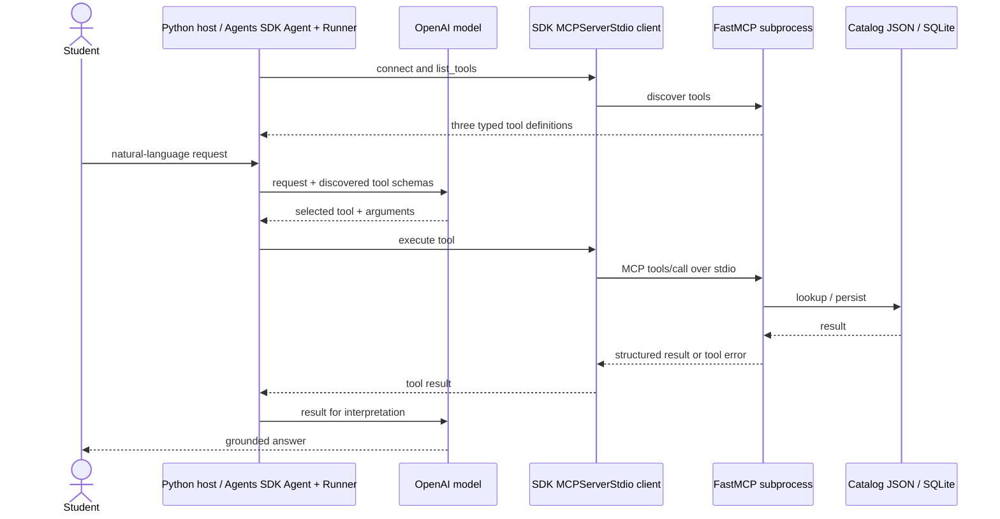

# CampusReads - a three-tool MCP toolkit

EECE 503P/798S · C5 Agent Tools · Joud Senan

CampusReads helps a student search a small library catalog and build persistent reading lists. The catalog is a **bundled demonstration dataset**, not a live university catalog. Saving a book changes a local SQLite database; it does not reserve or borrow a physical book.

**Screencast:** [CampusReads: MCP Toolkit Demo with FastMCP & OpenAI Agents SDK](https://youtu.be/5KXVjjvgGrw)

**Source code:** [Joud158/campusreads-mcp-toolkit](https://github.com/Joud158/campusreads-mcp-toolkit)

## Exactly three tools

| MCP tool | Category | Inputs | Structured output | Predictable failure |
|---|---|---|---|---|
| `search_catalog` | Data | `query: str`, `limit: int = 5` | `SearchResult`: query, total_matches, books | Blank/punctuation-only query; missing catalog |
| `save_reading_item` | Action | `book_id: str`, `list_name: str` | `SaveResult`: created/already_saved, list, book, timestamp | Unknown book; unwritable storage |
| `plan_reading` | Orchestration | `query: str`, `list_name: str` | `PlanResult`: query, selection rule, steps, save receipt | No matches, with no write |

Every entry point uses `@mcp.tool` with typed inputs, descriptions, a Pydantic output model, and MCP annotations. The data lookup is exposed as a callable tool so that an Agents SDK agent can select it directly. The server exposes exactly these three tools.

## Architecture



`MCPServerStdio` is the SDK class name; it manages the **client-side** connection and server process. The host is `agent.py`. FastMCP is the server. MCP supplies the interface and transport; the model and `Runner` decide which tool to invoke.

The orchestration tool delegates to the **same service methods** used by the data and action entry points, in sequence. It does not make nested MCP requests to itself. This keeps one implementation for each operation and avoids a second connection. Its `steps` result and server logs make the composition visible.

## Setup (Python 3.11+)

Run these commands from this directory in PowerShell:

```powershell
python -m venv .venv
.\.venv\Scripts\python -m pip install -r requirements.txt
```

Activation is optional; all commands below explicitly use the virtual environment. On macOS/Linux, use `.venv/bin/python` instead. Direct dependencies are pinned to the tested versions. A complete environment snapshot is in `requirements-lock.txt`.

### Verify without an API key

```powershell
.\.venv\Scripts\python -m pytest -q
.\.venv\Scripts\python -m library_toolkit.demo
```

The protocol demo starts a real FastMCP subprocess through the OpenAI Agents SDK MCP client. It verifies exactly three discovered tools, all three successful calls, duplicate safety, three failure paths, and persisted rows. It uses a temporary database and deletes it on exit. This demo verifies the protocol without calling an LLM. The test suite additionally exercises the actual Agents SDK Runner with a scripted model and real MCP subprocess, checking SDK integration without consuming API credits.

### Run the live OpenAI agent

```powershell
Copy-Item .env.example .env
# Open .env in your editor and fill in OPENAI_API_KEY.
.\.venv\Scripts\python -m library_toolkit.agent --demo
```

Use an API key with model access and API billing. `OPENAI_MODEL` defaults to `gpt-4.1-mini`; change it to a model your account supports if necessary. Credentials are loaded from `.env` and never printed. `.env` is ignored by Git. Built-in remote tracing is disabled; request/response evidence is printed locally.

The six scripted prompts are submitted to a **real model**, which selects tools through the SDK. Nothing in the host preselects a tool. The model's actual tool name, arguments, structured result, and final answer are printed. The scripted demo uses a fresh temporary database so saves are reproducible; its data is removed on exit.

For interactive use with durable storage:

```powershell
.\.venv\Scripts\python -m library_toolkit.agent
```

Example requests:

1. `Search the catalog for agents. Do not save anything.`
2. `Save B001 to my semester reading list.`
3. `Find a machine learning book and save it to my semester reading list.`
4. Repeat request 3: expect `already_saved`.
5. `Find and save a book about underwater basket weaving to my semester list.`
6. `Save B999 to my semester list.`

Interactive history is retained until exit. Default storage is `storage/reading_list.sqlite3`; override it with `LIBRARY_DB_PATH`. To inspect the external effect without adding a fourth MCP tool:

```powershell
.\.venv\Scripts\python -c "import sqlite3; c=sqlite3.connect('storage/reading_list.sqlite3'); print(c.execute('SELECT * FROM reading_items').fetchall()); c.close()"
```

To start the server alone: `.\.venv\Scripts\python -m library_toolkit.server`. It waits for MCP input; it is not an interactive chat. Diagnostic logs use stderr, preserving stdout for the protocol.

## Behavior and boundaries

- Searches require all whitespace/punctuation-separated words to appear as substrings in the combined ID/title/author/topics. Results sort by title, then ID. They are deterministic, not semantic recommendations.
- An ordinary search with no matches returns an empty list. A find-and-save request with no matches returns `NO_MATCHES`, because the requested workflow cannot complete.
- Lists are trimmed and case-insensitive. A database primary key on `(list_name, book_id)` prevents duplicates, including concurrent inserts. Retrying a successful save preserves its timestamp.
- SQLite writes are transactional. Invalid input and failed searches do not create saved entries. Schema validation and expected application failures become MCP error results; the agent must not report success for an error.
- The catalog is packaged locally, allowing repeatable demonstrations without an external catalog service. Only the live model run needs network access.
- This is a local, single-user prototype. Authentication, a real catalog integration, semantic ranking, and UI-based list management are possible future work.

## Project files

- [Reading summary](docs/summary.md): 300–400 word article summary and existing-server critique, with sources.
- [Reflection](docs/reflection.md): design decisions, tool boundaries, and future work.
- [Screencast](https://youtu.be/5KXVjjvgGrw): project walkthrough and agent demonstration.
- [Protocol demo output](docs/protocol-demo-output.txt): captured MCP requests, results, and failure cases.
- `library_toolkit/`: server, SDK host, service, sample catalog, and no-key protocol demo.
- `tests/`: behavior, failure, schema, and MCP integration checks.

Local credentials, the virtual environment, generated storage, and caches are excluded from version control.

## References

Implementation follows the [FastMCP tool documentation](https://gofastmcp.com/servers/tools), the [OpenAI Agents SDK MCP guide](https://openai.github.io/openai-agents-python/mcp/), and [official OpenAI integration guidance](https://developers.openai.com/api/docs/guides/agents/integrations-observability). Reading sources and the explored Fetch implementation are linked in the summary.
